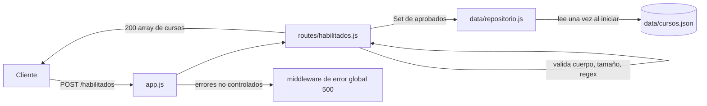

# Diseño: Cursos habilitados

## Overview

Endpoint `POST /habilitados` que calcula, a partir de una lista de cursos aprobados, los cursos de `data/cursos.json` que el alumno puede matricular: los no aprobados cuyos requisitos están todos en la lista de aprobados (los cursos sin requisitos siempre habilitados). Reutiliza el repositorio en memoria existente.

## Architecture

La aplicación Express existente monta un nuevo router en `/habilitados`, que depende del repositorio en memoria. No hay nuevas dependencias: solo Express, Jest, supertest y built-ins de Node.



## Components and Interfaces

| Componente | Responsabilidad |
| --- | --- |
| `src/routes/habilitados.js` (nuevo) | Router Express que expone `POST /habilitados`: valida el cuerpo (presencia, tipo array, elementos string, formato `^[A-Z0-9]{6}$`, tamaño ≤ 150), construye un `Set` de aprobados, llama a `listarHabilitados` y responde 200 con el array. Los errores de validación responden 400 con `{ "error": ... }`. |
| `src/data/repositorio.js` (modificado) | Añade `listarHabilitados(aprobadosSet)`: recibe un `Set` de códigos aprobados y devuelve el array de cursos habilitados (no aprobados y con todos los requisitos dentro del `Set`). |
| `src/app.js` (modificado) | Monta el nuevo router en `/habilitados`, antes del middleware de error global (que ya existe y no se duplica). |
| `tests/habilitados.test.js` (nuevo) | Tests de ruta con supertest, al menos uno por criterio de aceptación de los requisitos 1 a 4. |

### Contratos

Request `POST /habilitados`:

```json
{
  "aprobados": ["1INF25", "1INF27", "1INF49"]
}
```

- `aprobados`: obligatorio, array de strings, máximo 150 elementos, cada elemento debe cumplir `^[A-Z0-9]{6}$`.

Response 200 (array, posiblemente vacío, de objetos de curso):

```json
[
  {
    "id": "1INF30",
    "name": "Programación 3",
    "credits": 5.0,
    "cycle": 6,
    "type": "obligatorio",
    "prerequisites": ["1INF25"]
  }
]
```

### Lógica de filtrado

1. Convertir `aprobados` (array validado) en un `Set` llamado `aprobadosSet` (O(1) por consulta, elimina duplicados).
2. Recorrer `repositorio.listar()` (los 87 cursos en memoria).
3. Para cada curso `c`:
   - Si `aprobadosSet.has(c.id)`, descartarlo (ya aprobado).
   - Si `c.prerequisites.every((pr) => aprobadosSet.has(pr))` es verdadero, incluir `c`; si no, descartarlo. Un curso con `prerequisites: []` pasa `every` automáticamente, por lo que siempre está habilitado mientras no esté aprobado.
4. Devolver los cursos incluidos en el orden de `listar()` (orden del JSON fuente, agrupado por ciclo).

Complejidad: O(C × P) con C = 87 cursos y P = máx. de requisitos por curso (≤ 2 en la malla actual); trivialmente por debajo de 1 segundo para 150 aprobados.

## Data Models

No hay persistencia nueva: los datos viven en `data/cursos.json` (87 cursos) y se cargan en memoria una vez al iniciar.

Modelo de curso (fuente de verdad, sin transformación):

```json
{
  "id": "1INF30",
  "name": "Programación 3",
  "credits": 5.0,
  "cycle": 6,
  "type": "obligatorio",
  "prerequisites": ["1INF25"]
}
```

- `id`: string, 6 caracteres `[A-Z0-9]`.
- `name`: string.
- `credits`: number.
- `cycle`: entero 5-10 o `null` (electivos).
- `type`: `"obligatorio"` o `"electivo"`.
- `prerequisites`: array de ids de curso (puede ser vacío).

Modelo de la solicitud: `{ "aprobados": string[] }`, validado en el router antes de cualquier cálculo.

## Error Handling

| Caso | Respuesta | Cuerpo |
| --- | --- | --- |
| Falta el campo `aprobados` | `400` | `{ "error": "el campo aprobados es obligatorio" }` |
| `aprobados` no es array (ej. string) | `400` | `{ "error": "aprobados debe ser un array de strings" }` |
| Algún elemento no es string (ej. `[1, null]`) | `400` | `{ "error": "aprobados debe ser un array de strings" }` |
| Elemento con formato inválido (no `^[A-Z0-9]{6}$`) | `400` | `{ "error": "código de curso inválido" }` |
| Más de 150 elementos | `400` | `{ "error": "la lista no puede tener más de 150 elementos" }` |
| Cuerpo no es JSON válido | `400` | `{ "error": "cuerpo JSON inválido" }` (manejado por el error handler de `express.json()`, ajustado a este formato) |
| Error interno no controlado | `500` | `{ "error": "error interno del servidor" }` (middleware global existente, sin stack trace) |

Los mensajes de error nunca incluyen stack traces ni rutas de archivos.

## Decisiones

| # | Decisión | Razón |
| --- | --- | --- |
| a. Lista vacía (`aprobados: []`) | Devuelve 200 con todos los cursos sin requisitos y ningún curso con requisitos | Criterio 2.4 lo exige: `every` sobre una lista vacía de requisitos es verdadero, y ningún curso con requisitos puede cumplirlo. La lista vacía es una entrada válida, no un error. |
| b. Códigos duplicados | Se aceptan y se colapsan al construir el `Set` | El `Set` elimina duplicados de forma natural; el resultado no depende de repeticiones y rechazarlos complicaría el cliente sin beneficio. El chequeo de tamaño (≤ 150) se aplica sobre el request original. |
| c. Código válido no existente en la malla (ej. `1INF99`) | Se acepta silenciosamente | Validar contra la malla acoplaría el endpoint al dataset y cambiaría el contrato si la malla crece; un código aprobado inexistente no afecta el cálculo (no matchea ningún prerequisito). El criterio 4.1 solo exige el formato. |
| d. Minúsculas (ej. `1inf25`) | Se rechazan con 400 | El regex `^[A-Z0-9]{6}$` es explícito en el criterio 4.1; los códigos de la malla son mayúsculas y no hay motivo para normalizar. Rechazar da un error claro y predecible. |
| e. Orden de la respuesta | Orden definido: el de `listar()`, que es el orden del JSON fuente (aprox. por ciclo 5 a 10, luego electivos) | Un orden estable simplifica los tests y el consumo del front-end; el filtrado recorre `listar()` una sola vez y no reordena, así que este orden sale gratis. |
| f. Forma de la respuesta | Cada objeto incluye `id`, `name`, `credits`, `cycle`, `type` y `prerequisites` (códigos) | El mínimo exigido es `id` y `name` (criterio 1.1), pero devolver el objeto completo del repositorio evita un mapeo extra y da al cliente créditos, ciclo y requisitos para la matrícula. `prerequisites` se devuelve como códigos planos (el endpoint `GET /cursos/:codigo` ya ofrece la versión resuelta con nombres). |

## Gates de calidad y seguridad

| Gate | Herramienta y umbral | Bloquea / avisa | Etapa | Razón |
| --- | --- | --- | --- | --- |
| Cobertura (5.1) | `jest --coverage` con `coverageThreshold.global.lines = 80`: falla si la cobertura de líneas es menor a 80 % | Bloquea (el job falla) | `pull_request` y `push` a main | La política fija un piso de 80 % de líneas para todo cambio que llega a main; se mide líneas porque es la unidad de la política. Corre en el PR para detectar código sin pruebas antes de integrar, y en el push a main porque en este repo también se integra con push directo. |
| SCA (5.2) | `npm audit --audit-level=high` sobre todas las dependencias (sin `--omit=dev`) | Bloquea | `pull_request` y `push` a main | `--audit-level=high` falla solo con severidad high o critical, que es exactamente la política: `critical` dejaría pasar las high y `moderate` bloquearía hallazgos que la política acepta. No se usa `--omit=dev` porque la política dice "ninguna dependencia" y las de desarrollo también se ejecutan en el runner. |
| Secretos (5.3) | gitleaks sobre todo el historial (`fetch-depth: 0`); umbral: 0 hallazgos | Bloquea | `pull_request` y `push` a main | Un secreto subido ya está expuesto, así que no hay umbral tolerable. Se escanea el historial completo porque borrar el archivo en el último commit no elimina la clave de los commits anteriores. Un hallazgo solo se registra en `.gitleaksignore` si la clave fue rotada, con su razón. |

## Correctness Properties

*A property is a characteristic or behavior that should hold true across all valid executions of a system-essentially, a formal statement about what the system should do. Properties serve as the bridge between human-readable specifications and machine-verifiable correctness guarantees.*

### Property 1: Equivalencia con el modelo de referencia

*Para cualquier* lista válida de aprobados (subconjunto de códigos con formato `^[A-Z0-9]{6}$`), la respuesta debe ser exactamente el conjunto de cursos `c` tal que `c.id` no está en la lista de aprobados y todos los elementos de `c.prerequisites` están en la lista de aprobados. Esto subsume: ningún aprobado aparece en la respuesta, ningún curso con requisito faltante aparece, y todos los cursos sin requisitos no aprobados aparecen.

**Validates: Requirements 1.2, 1.3, 1.4, 2.4**

### Property 2: Rechazo de elementos inválidos

*Para cualquier* cuerpo donde `aprobados` no es un array de strings con formato `^[A-Z0-9]{6}$` (elemento numérico, null, booleano, objeto, string con minúsculas, con caracteres especiales, o longitud distinta de 6), el sistema responde 400 con un mensaje en el campo `error` y no calcula resultados.

**Validates: Requirements 2.1, 2.2, 2.3, 4.1**

### Property 3: Rechazo por tamaño

*Para cualquier* lista `aprobados` con más de 150 elementos (todos válidos), el sistema responde 400 con un mensaje en el campo `error`.

**Validates: Requirements 3.1**

### Property 4: Estabilidad ante reorden y duplicados

*Para cualquier* lista válida de aprobados, reordenar sus elementos o duplicarlos (manteniendo el tamaño ≤ 150) produce la misma respuesta.

**Validates: Requirements 1.2, 1.3**

## Testing Strategy

Doble enfoque: tests de ejemplo (supertest) para los casos concretos de la malla real, y tests de propiedades con generadores aleatorios (100 iteraciones mínimo, sin dependencias nuevas: subconjuntos aleatorios con PRNG sembrado) para las propiedades universales.

- **1.1**: POST con `["1INF25","1INF27","1INF49"]` → 200, 27 cursos, incluye 1INF29/1INF30/1INF31/1INF32, cada objeto con `id` y `name` (ejemplo).
- **1.5**: POST con `["1INF25","1INF27","1INF49","1IND90","1INF28","1INF33"]` → incluye 1CON27 y 1INF29-1INF32, no incluye 1INF34 (ejemplo).
- **1.2, 1.3, 1.4, 2.4** (Property 1): 100 subconjuntos aleatorios de códigos de la malla, POST a cada uno, verificar contra el modelo de referencia calculado en el test leyendo `data/cursos.json` directamente.
- **2.1**: POST sin campo `aprobados` → 400 con `error`.
- **2.2**: POST con `{"aprobados": "1INF25"}` → 400, sin resultados.
- **2.3** (Property 2, con generador): POST con `[1, null]` y variantes (número, null, boolean, objeto) → 400.
- **3.1**: POST con 151 códigos válidos → 400 con `error`; con 150 → 200.
- **3.2**: POST con 150 códigos válidos → 200 en menos de 1 segundo.
- **4.1** (Property 2, con generador): POST con `"1INF30<script>"`, `"1inf25"` y 100 strings inválidas generadas (minúsculas, `<script>`, longitudes 5 y 7) → 400.
- **4.2**: POST con cuerpo no JSON (`set('Content-Type','application/json').send('no json')`) → 400 con `error`.
- **4.3**: stub de `repositorio.listarHabilitados` que lanza → 500 con el cuerpo exacto `{"error": "error interno del servidor"}`, sin stack.
- **5.1, 5.2, 5.3**: gates del pipeline (CI), no PBT; se validan con la ejecución del workflow en el PR.
